## Hi, I'm Ikki Nishihara (西原 一輝) 👋

- 🎓 4th-year undergrad @ [Kanazawa Lab](https://www.akita-pu.ac.jp/gakubu/kyoin/kyoin-sys/123) (Environmental Management), Akita Prefectural University
- 🦞 Research: tracking invasive crayfish with citizen science × environmental DNA — [Zaridasu](https://zaridasu.com)
- 💼 Running [Lilac](https://rairakku.com), my web & app development studio
- 🚀 [100 Days / 100 Apps](https://rairakku.com/100days/) — one small web app a day, built with AI coding agents
- 🧩 [Merged pull requests](https://github.com/search?q=author%3Aharanishi+is%3Apr+is%3Amerged+-user%3Aharanishi&type=pullrequests) to ArtCraft, Turso, Babylon.js, Leaflet and more
- 📫 Links: [rairakku.com/lab/links](https://rairakku.com/lab/links/)

## 🌱 Skills

<!-- In srcset, commas split image candidates (GitHub cut the URL after the first icon), so keep them encoded as %2C. -->

<picture>
  <source media="(max-width: 600px) and (prefers-color-scheme: light)" srcset="https://skillicons.dev/icons?i=ts%2Cjs%2Chtml%2Ccss%2Cpy%2Crust%2Cswift%2Ccs%2Creact%2Cnextjs%2Cvite%2Ctailwind%2Cthreejs%2Castro%2Cnodejs%2Cwasm%2Csupabase%2Cpostgres%2Csqlite%2Ccloudflare%2Cworkers%2Cvercel%2Cvitest%2Cgithubactions&perline=6&theme=light">
  <source media="(max-width: 600px)" srcset="https://skillicons.dev/icons?i=ts%2Cjs%2Chtml%2Ccss%2Cpy%2Crust%2Cswift%2Ccs%2Creact%2Cnextjs%2Cvite%2Ctailwind%2Cthreejs%2Castro%2Cnodejs%2Cwasm%2Csupabase%2Cpostgres%2Csqlite%2Ccloudflare%2Cworkers%2Cvercel%2Cvitest%2Cgithubactions&perline=6">
  <source media="(prefers-color-scheme: light)" srcset="https://skillicons.dev/icons?i=ts%2Cjs%2Chtml%2Ccss%2Cpy%2Crust%2Cswift%2Ccs%2Creact%2Cnextjs%2Cvite%2Ctailwind%2Cthreejs%2Castro%2Cnodejs%2Cwasm%2Csupabase%2Cpostgres%2Csqlite%2Ccloudflare%2Cworkers%2Cvercel%2Cvitest%2Cgithubactions&perline=12&theme=light">
  
</picture>

+ Playwright · Hono · Drizzle · Turso · Phaser · Google&nbsp;Apps&nbsp;Script

## 🛠️ Tools

<picture>
  <source media="(max-width: 600px) and (prefers-color-scheme: light)" srcset="https://skillicons.dev/icons?i=git%2Cgithub%2Cvscode%2Cfigma%2Cps%2Cai%2Cpr%2Cae%2Cblender%2Cunity%2Cobsidian%2Cnotion&perline=6&theme=light">
  <source media="(max-width: 600px)" srcset="https://skillicons.dev/icons?i=git%2Cgithub%2Cvscode%2Cfigma%2Cps%2Cai%2Cpr%2Cae%2Cblender%2Cunity%2Cobsidian%2Cnotion&perline=6">
  <source media="(prefers-color-scheme: light)" srcset="https://skillicons.dev/icons?i=git%2Cgithub%2Cvscode%2Cfigma%2Cps%2Cai%2Cpr%2Cae%2Cblender%2Cunity%2Cobsidian%2Cnotion&perline=12&theme=light">
  
</picture>

+ Claude Code · Codex · Xcode

## 🧪 Also Tried

<picture>
  <source media="(max-width: 600px) and (prefers-color-scheme: light)" srcset="https://skillicons.dev/icons?i=kotlin%2Candroidstudio%2Cflutter%2Cdart%2Cgo%2Cdeno%2Cdocker%2Cfastapi%2Cunreal&perline=6&theme=light">
  <source media="(max-width: 600px)" srcset="https://skillicons.dev/icons?i=kotlin%2Candroidstudio%2Cflutter%2Cdart%2Cgo%2Cdeno%2Cdocker%2Cfastapi%2Cunreal&perline=6">
  <source media="(prefers-color-scheme: light)" srcset="https://skillicons.dev/icons?i=kotlin%2Candroidstudio%2Cflutter%2Cdart%2Cgo%2Cdeno%2Cdocker%2Cfastapi%2Cunreal&perline=12&theme=light">
  
</picture>

## 🦞 Crayfish Contributions

<picture>
  <source media="(prefers-reduced-motion: reduce) and (prefers-color-scheme: light)" srcset="https://raw.githubusercontent.com/haranishi/haranishi/output/crayfish-light-still.svg">
  <source media="(prefers-reduced-motion: reduce)" srcset="https://raw.githubusercontent.com/haranishi/haranishi/output/crayfish-dark-still.svg">
  <source media="(max-width: 600px) and (prefers-color-scheme: light)" srcset="https://raw.githubusercontent.com/haranishi/haranishi/output/crayfish-light-sm.svg">
  <source media="(max-width: 600px)" srcset="https://raw.githubusercontent.com/haranishi/haranishi/output/crayfish-dark-sm.svg">
  <source media="(prefers-color-scheme: light)" srcset="https://raw.githubusercontent.com/haranishi/haranishi/output/crayfish-light.svg">
  
</picture>
