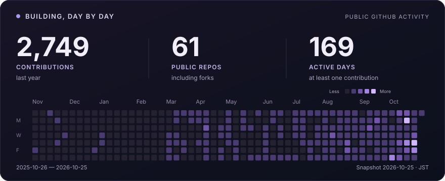

<samp>IKKI NISHIHARA · PRODUCT BUILDER · JAPAN</samp>

<picture>
  <source media="(prefers-reduced-motion: reduce) and (max-width: 600px)" srcset="./assets/atelier-still-sm.svg">
  <source media="(prefers-reduced-motion: reduce)" srcset="./assets/atelier-still.svg">
  <source media="(max-width: 600px)" srcset="./assets/atelier-sm.svg">
  
</picture>

<h2 align="center">アイデアを、触れるプロダクトに。</h2>

  西原 一輝 / <strong>Ikki Nishihara</strong> 
  AIとつくる小さなWebアプリから、Rustの業務アプリ、みんなで遊ぶゲームまで。 
  つくって、公開して、使い心地を磨く。

  <a href="https://hundred-days.pages.dev/"><kbd>▶ つくったアプリを見る</kbd></a>
  &nbsp; · &nbsp;
  <a href="#projects">Projects</a>
  &nbsp; / &nbsp;
  <a href="#stack">Stack</a>
  &nbsp; / &nbsp;
  <a href="#open-source">Open Source</a>
  &nbsp; / &nbsp;
  <a href="#activity">Activity</a>

## Projects

日々の小さな実験も、道具として育てるプロダクトも。実際に手を動かしているプロジェクトです。

### 01 / [hundred-days](https://github.com/haranishi/hundred-days)

**100日、100個のWebアプリ。** AIと一緒に、毎日ひとつ小さなアプリを制作・公開するチャレンジ。ゲーム、音、ビジュアル表現を試しています。

`JavaScript` `HTML / CSS` `Cloudflare Pages` · [アプリを見る ↗](https://hundred-days.pages.dev/)

### 02 / [irori](https://github.com/haranishi/irori)

**スマホがコントローラーになる、Webゲーム機。** 大画面を囲んで、みんなで遊ぶ。リアルタイム通信とゲーム用SDKを備えたOSSプロジェクトです。

`TypeScript` `WebSocket` `Cloudflare Workers` · Alpha

### 03 / [business-apps-rs](https://github.com/haranishi/business-apps-rs)

**業務アプリを、Rustで組み立てる。** 型付きフィールドから顧客・在庫・タスク管理へ。ブラウザーのUIからAPI、データ保存までをつなぐ基盤を開発中。

`Rust` `WebAssembly` `Axum` `SQLite` · 開発プレビュー

### 04 / [menu-bar-pet](https://github.com/haranishi/menu-bar-pet)

**メニューバーに、小さな相棒を。** CPU負荷やAIの使用枠に反応するmacOS向けペット。SwiftのネイティブUIとRustのコアを組み合わせています。

`Swift` `SwiftUI / AppKit` `Rust` · MVP

<a href="https://github.com/haranishi?tab=repositories&type=source">ほかの制作プロジェクトを見る →</a>

## Stack

プロジェクトで使っている技術。目的に合わせて、Web・ネイティブ・サーバーを行き来しています。

- **Web & interaction** — JavaScript / TypeScript / HTML / CSS / WebAssembly
- **Backend & data** — Rust / Axum / Tokio / SQLite / WebSocket
- **Native** — Swift / SwiftUI / AppKit
- **Delivery** — Cloudflare Pages / Workers / Durable Objects

## Open Source

自分のプロダクトをつくるだけでなく、使う道具にも手を入れています。外部リポジトリ向けに作成したPRは、[**73件がマージ済み**](https://github.com/search?q=author%3Aharanishi+is%3Apr+is%3Amerged+-user%3Aharanishi&type=pullrequests)（2026-10-25確認）。

- **[Leaflet / #10457](https://github.com/Leaflet/Leaflet/pull/10457)** — アイコンを変更した後も、マーカーのドラッグを継続できるように修正。
- **[Babylon-Lite / #841](https://github.com/BabylonJS/Babylon-Lite/pull/841)** — カスタム描画エフェクトに使えるRenderTargetパスの公開APIを追加。
- **[vectorcraft / #2847](https://github.com/storytold/vectorcraft/pull/2847)** — ルーラーの原点変更後に、ステータスバーの座標が正しく表示されるように修正。

## Activity

<a href="https://github.com/haranishi?tab=overview">
  <picture>
    <source media="(max-width: 600px)" srcset="./assets/activity-sm.svg">
    
  </picture>
</a>

過去1年のコントリビューション **2,749件** ／ 公開リポジトリ **61件**（うち[ソースリポジトリ32件](https://github.com/haranishi?tab=repositories&type=source)）。

2026-10-25時点の公開表示。集計期間：2025-10-26〜2026-10-25。数値とグラフは取得時点の記録です。最新の活動は<a href="https://github.com/haranishi?tab=overview">GitHubのプロフィール</a>へ。

---

<samp>SMALL IDEAS. REAL PRODUCTS. KEEP SHIPPING.</samp>

